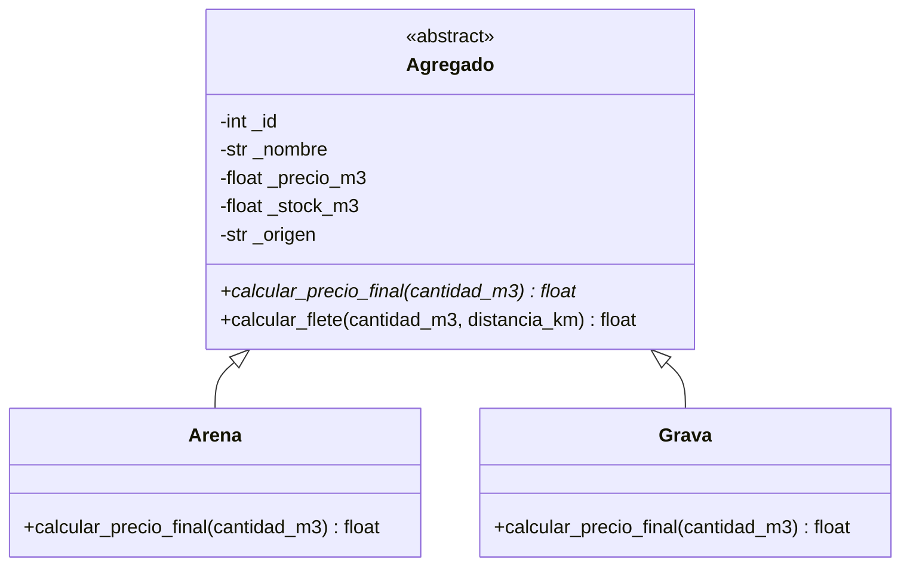

# Gesti?n de agregados - pr?ctica semana 10

Aplicaci?n CLI para una empresa ficticia, **Agregados del Valle**, que comercializa materiales por metro c?bico. Permite registrar arena y grava, consultar existencias y cotizar material m?s flete.

## Ejecuci?n

Requiere Python 3.11 o superior. Desde la carpeta del proyecto:

```bash
python main.py
```

No requiere paquetes externos.

## Operaci?n del sistema

1. Registra el material, precio por m?, existencias y origen.
2. Lista todos los productos con su ID y stock.
3. Cotiza indicando ID, volumen y distancia. Se valida que haya stock suficiente.
4. Se informa material, transporte y total.

Reglas de ejemplo para la pr?ctica: pedidos de arena desde 20 m? reciben 5% de descuento; la grava suma 8% por trituraci?n/clasificaci?n; transporte cuesta $900 COP por m? por km. Son par?metros did?cticos que una empresa real configurar?a seg?n sus costos y pol?tica comercial.

## Dise?o de clases



`Agregado` mantiene atributos encapsulados y propiedades con validaci?n. `Arena` y `Grava` sobrescriben `calcular_precio_final`; la cotizaci?n itera/usa objetos de la clase base y obtiene el comportamiento espec?fico por polimorfismo. Se usa herencia porque ambos materiales comparten identidad, precio, stock y origen, pero su regla de precio var?a por tipo. El flete es una operaci?n compartida, por eso vive en la clase base.

No se necesita herencia m?ltiple ni mixin en este dominio. Por tanto, el MRO de `Arena` es `Arena -> Agregado -> ABC -> object` (y equivalente para `Grava`). `super()` no es necesario: los subtipos no redefinen `__init__`, as? que heredan el constructor de `Agregado`. Se evita `__del__` porque Python no garantiza cu?ndo se ejecuta y el programa no administra recursos que requieran limpieza.

## Excepciones y validaci?n

`ValidationError` comunica errores de datos/reglas del negocio y `NotFoundError` identifica IDs inexistentes. Los setters de propiedades protegen el estado aun cuando se asigna desde c?digo. La CLI captura errores de dominio y de entrada; el flujo incluye `try/except/else/finally` con cierre de sesi?n garantizado.

## Estructura

- `main.py`: men?, flujo CLI e inventario en diccionario.
- `models/`: jerarqu?a POO de productos.
- `utils/`: excepciones, validadores y formato monetario.
- `requirements.txt`: no hay dependencias externas.

## Ejemplos para capturas de ejecuci?n

**Caso exitoso:** registrar arena (ID 1, 85000 COP/m?, 40 m?), despu?s cotizar 20 m? a 10 km. La arena aplica 5% de descuento y se muestra aparte el flete.

**Excepci?n de validaci?n:** al registrar, ingresar precio `-1`; la CLI captura el error y vuelve al men?.

**Excepci?n de elemento inexistente:** cotizar con un ID no registrado; la CLI presenta `NotFoundError` y vuelve al men?.

## Pr?ctica y roles

El c?digo est? separado en m?dulos y usa nombres en espa?ol, anotaciones de tipo, PEP 8, m?todos de clase y validaciones del dominio. Para el trabajo grupal, el equipo puede distribuir arquitectura/modelos, flujo CLI, validaciones/excepciones y documentaci?n/revisi?n.

## Interfaz web (HTML, CSS y JavaScript)

El proyecto incluye una interfaz web adaptable a celulares y computadores. El navegador se comunica con un servidor HTTP de Python que reutiliza las clases `Arena` y `Grava` para validar el inventario y calcular las cotizaciones.

Para iniciar el sistema desde la carpeta del proyecto:

```bash
python webapp.py
```

Luego abre `http://127.0.0.1:8000` en el navegador. El servidor guarda los materiales en `inventario.json`, que se crea al registrar el primero. Para detenerlo, usa `Ctrl+C` en la terminal.

- `web/index.html`: estructura del panel, formularios y tablas.
- `web/styles.css`: estilos adaptables y componentes visuales.
- `web/app.js`: carga del inventario, alta de materiales y cotizador.
- `webapp.py`: servidor local y API JSON; no requiere instalar paquetes.

El CLI original sigue disponible con `python main.py`. La aplicacion web comparte las reglas de negocio y los modelos, pero mantiene su inventario persistente en `inventario.json`.

El CLI y la interfaz web leen y escriben el mismo archivo `inventario.json`, ubicado en la carpeta del proyecto. Por eso, los materiales registrados desde el CLI aparecen al abrir el panel web, y los que se agreguen desde el panel se cargan la proxima vez que se inicie el CLI.
